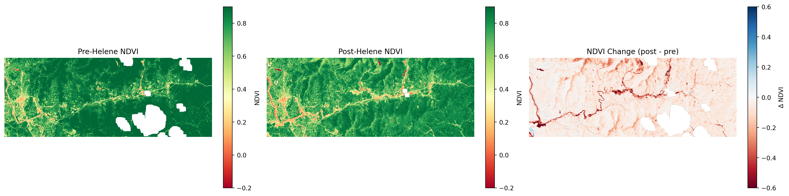
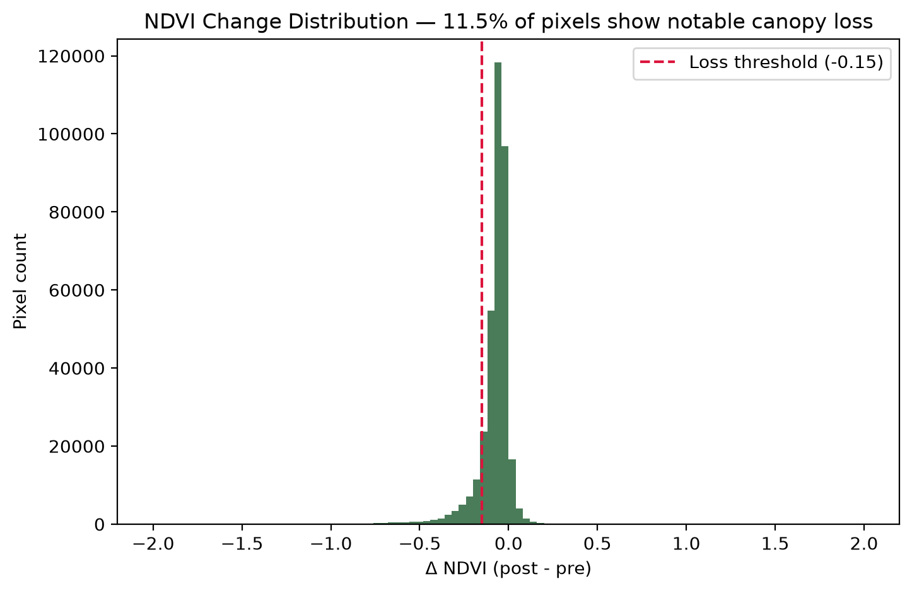

# Canopy Change Along the Swannanoa River Valley: Hurricane Helene (2024)

A geospatial analysis of vegetation/canopy loss in the Swannanoa River valley
(Black Mountain → Asheville, NC) using NDVI derived from NASA satellite
imagery, comparing conditions shortly before and after Hurricane Helene
(landfall 2024-09-27).

## Why this project

<!-- If you have a personal/local tie to Asheville or Western NC, a
     sentence here is worth more than anything else in this section. -->

I came into this with a CS degree, a Biology minor, and some GIS training
(ESRI/ArcGIS) from coursework and botanical fieldwork — but no prior
hands-on experience with satellite or Earth observation data. I built this
project to close that gap ahead of applying to NASA's EarthRISE Developers
Academy: to prove to myself, not just claim on an application, that I can
take a real disaster event, pull the actual NASA imagery, and turn it into
a defensible, quantified result end to end.

Hurricane Helene was the obvious choice of event: catastrophic,
well-documented flooding in Buncombe County's river valleys, and exactly
the kind of rapid-onset environmental change that satellite monitoring is
uniquely suited to quantify at scale — the class of problem EarthRISE is
built around.

## Background

Helene's remnants dropped record rainfall on the Southern Appalachians in
late September 2024, causing catastrophic flooding and debris flows along
the Swannanoa and French Broad Rivers. Buncombe County, NC — including
Black Mountain, Swannanoa, and Biltmore Village in Asheville — saw some of
the most severe damage to riparian forest and urban tree canopy in the
region.

This project quantifies that vegetation loss using the Normalized
Difference Vegetation Index (NDVI), a standard remote-sensing measure of
plant health and canopy density, computed from satellite surface
reflectance before and after the storm.

## Area of interest

The Swannanoa River corridor, rather than the full county, to keep the
analysis focused on a single watershed with a clear before/after flood
signal. See [`config/aoi_swannanoa.geojson`](config/aoi_swannanoa.geojson).

## Data

- **Source:** [NASA HLS (Harmonized Landsat Sentinel-2)](https://lpdaac.usgs.gov/products/hlsl30v002/),
  v2.0, via NASA's [Earthdata](https://www.earthdata.nasa.gov/) and the
  `earthaccess` Python client. HLS combines Landsat 8/9 and Sentinel-2 into
  a common 30 m grid, giving more frequent clear-sky revisits than Landsat
  alone — important for catching a cloud-free scene in the narrow pre/post
  storm windows.
- **Pre-event:** 2024-08-30 (HLS.L30.T17SLV, 17% cloud cover — the clearest
  Landsat pass available between May and landfall; every scene in the two
  weeks directly before Helene was 58%+ cloudy)
- **Post-event:** 2024-10-09 (HLS.L30.T17SLV, 0% cloud cover, 12 days after
  landfall)
- **Bands used:** Red and Near-Infrared (NDVI), plus the Fmask quality band
  for cloud/cloud-shadow/snow masking.

Both scenes are HLSL30 (Landsat 9) on the same MGRS tile, chosen
deliberately to avoid cross-sensor NDVI differences between Landsat and
Sentinel-2.

Raw and processed imagery are not committed to this repo (see
`.gitignore`) — they're large and fully reproducible via
[`src/search_download.py`](src/search_download.py).

## Method

1. **Search & download** matching HLS granules for the AOI and date
   windows (`src/search_download.py`).
2. **Compute NDVI** = (NIR − Red) / (NIR + Red) for each date, masking out
   cloud/shadow/snow pixels using the Fmask QA band (`src/ndvi.py`).
3. **Difference** the two NDVI rasters (post − pre); negative values
   indicate canopy/vegetation loss.
4. **Quantify and visualize**: side-by-side NDVI maps, a diverging
   difference map, and a histogram of the change distribution with a
   loss-threshold cutoff (`src/plotting.py`).

Full walkthrough in
[`notebooks/01_ndvi_before_after.ipynb`](notebooks/01_ndvi_before_after.ipynb).

## Results

| | Pre-Helene (2024-08-30) | Post-Helene (2024-10-09) |
|---|---|---|
| Mean NDVI (AOI) | 0.81 | 0.74 |

**11.5%** of pixels across the AOI show ΔNDVI < -0.15, the threshold used
here for "notable canopy/vegetation loss."



The difference map (right panel) shows a clear, continuous band of
vegetation loss tracing the Swannanoa River channel itself — consistent
with flood scouring and debris flows along the waterway — plus more
diffuse, scattered loss across the surrounding hillsides, likely from
wind damage.



## Limitations & next steps

This is a two-scene snapshot, not a time series, and it's honest to be
upfront about what that does and doesn't support:

- **Single before/after pair.** A cloud-free Landsat pass wasn't available
  in the two weeks immediately before landfall (every scene was 58%+
  cloudy), so the pre-event baseline is from Aug 30 — about four weeks
  before Helene. Normal late-summer phenology could account for a small
  slice of the observed NDVI drop, not just storm damage.
- **No ground truth.** The loss threshold (ΔNDVI < -0.15) is a reasonable
  convention, not validated against field survey or high-resolution
  post-storm aerial imagery of this specific corridor.
- **Wind vs. flood damage aren't separated.** The river-channel loss band
  and the diffuse hillside loss are visually distinguishable but not
  quantified as separate categories.

With more time, the next steps would be:

1. **A short NDVI time series** (monthly composites through 2024–2025) to
   separate the storm signal from normal seasonal variation and track
   canopy recovery.
2. **Overlay USGS/NOAA flood extent or NC landslide inventory data** on
   the ΔNDVI raster to formally split flood-driven riparian loss from
   wind-driven damage upslope.
3. **Validate against higher-resolution imagery** (e.g., NAIP or
   commercial post-storm aerials) for a subset of the corridor.

## Setup

Requires a free [NASA Earthdata Login](https://urs.earthdata.nasa.gov/)
account.

```bash
python -m venv .venv
source .venv/bin/activate
pip install -r requirements.txt

# First run prompts for Earthdata credentials and caches them in ~/.netrc
python src/search_download.py --start 2024-08-29 --end 2024-08-31 --max-cloud 20
python src/search_download.py --start 2024-10-08 --end 2024-10-10 --max-cloud 20

jupyter lab notebooks/01_ndvi_before_after.ipynb
```

## Repository structure

```
config/       AOI definition (GeoJSON)
src/          NDVI computation, HLS search/download, plotting utilities
notebooks/    Main analysis notebook
data/         Downloaded/processed rasters (gitignored)
outputs/      Exported figures
```

## License

MIT
